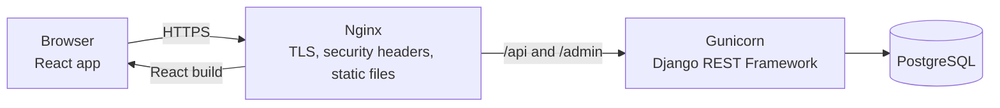
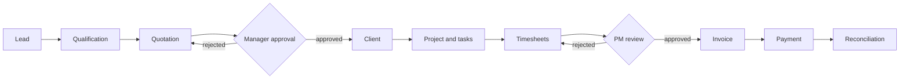

# OmniOS Enterprise Platform

A multi-branch enterprise management platform, built for the OmniTeckno Individual Full-Stack Development Challenge. One system manages employees and recruitment, CRM and sales quotations, projects and timesheets, invoices and payments, with role-based access and strict branch isolation. It is a working system, not only screens: every record lives in PostgreSQL, every business rule is enforced on the server, and financial transactions are simulated.


## Deployment status

- **Target environment:** a Linux server running Docker Compose with PostgreSQL, Django REST Framework behind Gunicorn, and Nginx serving the React build over HTTPS.
- **This submission runs:** _fill in honestly, for example "on a Linux VPS at https://..." or "from the developer's Linux (WSL2 Ubuntu) environment with Docker Compose, reachable through a temporary HTTPS tunnel at https://..."_.
- The same files deploy to any Ubuntu VPS with the commands in [docs/deployment.md](docs/deployment.md).

## 1. What the system does

Six roles (Super Admin, HR, Sales, Finance, Project Manager, Employee) work through one connected workflow:

**Lead → qualification → quotation → manager approval → client conversion → project and tasks → timesheets → invoice → payment reconciliation**

| Feature | What it covers |
|---|---|
| F01 Company and branches | Organization with logo, branches, branch managers, status |
| F02 User provisioning | Users, roles, branch access, activate and deactivate, password rules |
| F03 Employee directory | Employees, departments, positions, linked login accounts |
| F04 Recruitment | Vacancies, candidates with resumes, a seven-stage pipeline, interviews, notes |
| F05 Clients and leads | Leads, activities, qualification, atomic conversion to a client with duplicate checks |
| F06 Opportunities | Pipeline stages with probabilities and lost reasons |
| F07 Quotations | Line items, server-side totals, approval and rejection with reasons, revisions, conversion to a project |
| F08 Projects and tasks | Members, status workflow, task assignment, progress, reports |
| F09 Timesheets | Daily limits, submit, review, reject with reason, correct and resubmit |
| F10 Invoices and payments | Invoices built from approved work (never billed twice), partial payments, reconciliation |
| F11 Dashboards | Executive, HR, Sales, Projects and Finance, live from the database |
| F12 Notifications and audit | In-app notifications and an immutable audit log with before and after values |

## 2. Technology

| Layer | Technology |
|---|---|
| Frontend | React, React Router, TanStack Query, Axios, Vite, Vitest |
| Backend | Python, Django, Django REST Framework, SimpleJWT, drf-spectacular |
| Database | PostgreSQL 16 |
| Serving | Gunicorn, Nginx (HTTPS), Docker Compose |

## 3. Architecture



Every API request passes through the same layers: JWT authentication, a role permission class, branch scoping of the data, serializer validation, then a service layer that applies the business rules inside a database transaction. Audit entries and notifications are written in the same transaction as the change.



The database design, with an entity diagram per module and a full column reference, is in [docs/database.md](docs/database.md).

### Project structure

```
backend/
  config/                 settings, URLs, WSGI
  apps/
    accounts/ access_control/ organizations/ branches/    users, roles, company, branches
    hr/ recruitment/ crm/ sales/                           people and sales
    projects/ timesheets/ finance/                         delivery and money
    notifications/ audit/ reports/ core/                   notifications, audit log, dashboards, shared code
frontend/
  src/app/                router, guards, auth provider, screen map
  src/components/         layout, sidebar, tables, forms, modals
  src/pages/              one folder per module
  src/hooks/ utils/ services/api/
docs/                     database architecture, deployment guide, API schema
docker-compose.yml        PostgreSQL, backend and Nginx
```

## 4. Quick start with Docker (any Linux machine)

Requirements: Docker with Compose.

```bash
git clone <repository-url> omnios && cd omnios
cp .env.example .env            # then edit it: SECRET_KEY, DB_PASSWORD and the host names
mkdir -p deploy/certs
openssl req -x509 -nodes -newkey rsa:2048 -days 30 -subj "/CN=localhost" \
  -keyout deploy/certs/privkey.pem -out deploy/certs/fullchain.pem
docker compose up --build -d
docker compose run --rm backend python manage.py seed_demo --force      # demo data and logins
```
Open https://localhost and accept the warning for the self-signed certificate. The full guide, including a real HTTPS certificate, is in [docs/deployment.md](docs/deployment.md).

## 5. Local development

```bash
# database (once)
sudo -u postgres psql -c "CREATE USER omnios_user WITH PASSWORD 'change_me_strong' CREATEDB;" \
                      -c "CREATE DATABASE omnios_db OWNER omnios_user;"

# backend (http://localhost:8000)
cd backend && python3 -m venv venv && source venv/bin/activate
pip install -r requirements.txt
# create backend/.env with the variables below (DEBUG=True, DB_HOST=localhost)
python manage.py migrate && python manage.py seed_roles
python manage.py seed_demo           # optional demo data
python manage.py runserver

# frontend (http://localhost:5173, use localhost and not 127.0.0.1)
cd frontend && npm install && npm run dev
```

## 6. Environment variables

| Variable | Purpose |
|---|---|
| `SECRET_KEY` | Django secret. At least 50 characters when `DEBUG=False`. |
| `DEBUG` | `True` for development only. |
| `ALLOWED_HOSTS` | Comma-separated host names. Include `localhost` (used by the health check). |
| `DB_NAME`, `DB_USER`, `DB_PASSWORD`, `DB_HOST`, `DB_PORT` | PostgreSQL connection. |
| `CORS_ALLOWED_ORIGINS` | Browser origins allowed to call the API (development). |
| `CSRF_TRUSTED_ORIGINS` | Origins trusted for the Django admin over HTTPS. |
| `NUM_PROXIES` | Proxies in front of Django (1 behind Nginx). Used by the login rate limit. |
| `SECURE_SSL_REDIRECT` | Redirect HTTP to HTTPS in production. |
| `ADMIN_USERNAME`, `ADMIN_EMAIL`, `ADMIN_PASSWORD` | Optional: create the first Super Admin when the container starts. |
| `VITE_API_URL` (frontend) | API base URL. `/api/v1` in Docker, `http://localhost:8000/api/v1` in development. |

Secrets are never stored in the source code: `.env` is git-ignored, and `.env.example` shows the shape.

## 7. Seed data and test accounts

```bash
python manage.py seed_roles                                   # the six official roles (safe to repeat)
python manage.py create_admin --username admin --email admin@example.com --password '...'
python manage.py seed_demo                                    # fictional data and one login per role
```
`seed_demo` builds its data through the same service functions as the API, so history, totals and statuses are consistent. It refuses to run when `DEBUG=False` unless you pass `--force`. Use it on demo systems only.

Demo logins (password for all: `OmniOS#Demo2026`):

| Username | Role | Branch |
|---|---|---|
| `admin` | Super Admin | all |
| `hr` | HR | Head Office |
| `sales` | Sales | Head Office |
| `sales_manager` | Sales and branch manager (approves quotations) | Head Office |
| `finance` | Finance | Head Office |
| `pm` | Project Manager | Head Office |
| `employee` | Employee | Head Office |
| `sales_east` | Sales | East Branch (shows branch isolation) |

## 8. API documentation and authentication

- **Swagger UI:** `/api/v1/docs/`. **OpenAPI schema:** `/api/v1/schema/`, exported to [docs/openapi.yml](docs/openapi.yml).
- All endpoints are under `/api/v1/`. Responses use one envelope: `{ "success": true, "message": "OK", "data": {}, "errors": null }`. Errors return `success: false`, a message and field-level `errors` (400 validation, 401 not signed in, 403 not allowed, 404 not found or outside your branches, 429 too many attempts).
- **Authentication:** JWT. `POST /auth/login/` returns an `access` token (30 minutes) and a `refresh` token (1 day, rotated, and revoked on logout). Send `Authorization: Bearer <access>`. `POST /auth/refresh/`, `POST /auth/logout/` and `GET /auth/me/` complete the flow. The API uses header tokens, not cookies, so it is not exposed to CSRF. The Django admin uses sessions with CSRF protection.

## 9. Roles and permissions

Roles are permission templates. The backend checks role and branch on every request, and the screens only mirror those rules.

| Area | Super Admin | HR | Sales | Finance | Project Manager | Employee |
|---|---|---|---|---|---|---|
| Organization, branches, users | Yes | – | – | – | – | – |
| Employee directory | Yes | Manage | Read | Read | Read | Own |
| Recruitment | Yes | Yes | – | – | – | – |
| Leads, opportunities | Yes | – | Yes | – | – | – |
| Clients | Yes | – | Manage | Read | Read | – |
| Quotations | Yes | – | Manage | Read | – | – |
| Quotation approval | Yes | – | Branch manager | – | – | – |
| Projects | Yes | – | Read | Read | Manage | Assigned |
| Tasks | Yes | – | Read | – | Manage | Assigned (status) |
| Timesheets | Yes | Read | – | Approved only | Review | Own |
| Invoices | Yes | – | Read | Manage | Own projects | – |
| Payments | Yes | – | – | Manage | – | – |
| Audit logs | Yes | HR modules | – | Finance module | Project modules | – |

## 10. Security controls

| Control | How |
|---|---|
| Server-side authorization | A permission class on every endpoint, verified for all six roles on every endpoint by an automated permission-matrix test |
| Branch isolation | Every query is scoped to the user's branches, and creating records in another branch is refused. Dashboards, search and reports follow the same rule |
| Authentication | JWT with short-lived access tokens, rotated and blacklisted refresh tokens, deactivated users blocked immediately |
| Passwords | Hashed (PBKDF2), validated for strength, never logged |
| Brute-force protection | Login limited to 5 attempts per minute per IP, plus general API rate limits |
| Input validation | DRF serializers plus service-layer business rules, with useful field errors |
| Transport and headers | HTTPS redirect, HSTS, CSP, X-Frame-Options, nosniff (Nginx and Django) |
| Audit trail | Immutable log of changes with previous and new values, user, branch and IP |
| Secrets | Environment variables only, nothing in the repository |
| Uploads | Resume type and size limits, logo type and size limits, upload size caps in Django and Nginx |
| SQL injection | ORM only, no raw SQL |

## 11. Testing

```bash
cd backend && source venv/bin/activate && python manage.py test apps     # more than 140 tests
cd frontend && npm test                                                   # more than 50 tests
```
Backend tests cover authentication, a permission matrix for every endpoint and role, branch isolation, lead qualification and conversion, quotation approval, project and task rules, timesheet review, invoice and payment rules, validation, audit, notifications, dashboards, and one end-to-end test that runs the whole workflow (lead to payment) through the API. Frontend tests cover login, role-based navigation, route guards, forms and validation errors, loading and empty states, pagination and approval dialogs.

## 12. Branding and interface

The interface follows the OmniTeckno identity: the official logo on the login page, sidebar and browser tab, and a consistent set of colors, buttons, icons and components defined once (colors are CSS variables at the top of `frontend/src/styles/app.css`). The layout is responsive for desktop, tablet and mobile, with keyboard focus styles, labelled form fields, a skip link and reduced-motion support. The references used were www.omniteckno.com and www.omnios.us.

## 13. Known limitations

- Payments are simulated records. There is no payment gateway.
- Quotation "authorized manager" means the branch manager (a Sales user set as the branch's manager) or a Super Admin. Nobody can approve their own quotation, not even a Super Admin.
- "Limited" access in the specification is implemented as: HR reads timesheets and HR-module audit entries (no drafts), Finance reads approved timesheets only, Sales and Project Managers read invoices (Project Managers only for their own projects).
- Roles and branch access are assigned through the user form. There are no separate user-role endpoints and no Roles screen, because the six roles are fixed.
- An invoice covers one project at one hourly rate, with lines grouped per task. Amounts in different currencies are reported separately and never converted. Draft invoices are recreated rather than edited in the screens.
- Employees log time against tasks assigned to them.
- A hired candidate is not turned into an employee automatically. An interview time is set when the application moves to that stage and cannot be changed afterwards.
- There is no system-settings screen and no self-service password reset (a Super Admin resets passwords). Notifications are in-app only and refresh every 60 seconds.
- Tokens are kept in browser storage, which would be exposed by an XSS flaw. A strict Content-Security-Policy reduces that risk.
- The audit log records changes, not reads. The login rate limit is per IP address.
- Invoice, payment and project numbers use "last number plus one", which is fine at this scale but could collide under heavy simultaneous writes.
- Demo accounts and demo data exist for evaluation only.
